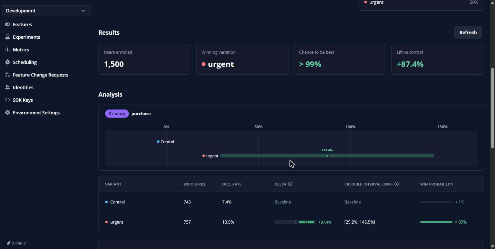

# flagsmith-experiment-closeout

[](https://github.com/calebjohndan-hoop/flagsmith-experiment-closeout/actions/workflows/test.yml)

**An Agent Skill that finishes what an A/B test starts.** It reads a Flagsmith experiment's results, decides whether there's a real winner, ships it after explicit human approval, verifies the live flag, plans the cleanup, and writes a decision record your team can find later.

Built for **WeMakeDevs Toggle Wars: Flagsmith Agent Skills**.

> Flagsmith's own agent prompt takes you from an idea to a *running* experiment. This skill covers the part after that, where teams usually lose time: reading the numbers correctly, deciding, rolling out, and deleting the flag before it becomes tech debt.

## The problem

Starting an experiment is easy. Ending one well is where things go wrong:

- People ship on a "95% chance to win" whose credible interval still crosses zero.
- A broken traffic split (sample ratio mismatch) goes unnoticed, so decisions rest on groups that aren't comparable.
- A winning variation quietly breaks a guardrail metric.
- The flag gets left half rolled out, and the losing code path stays in the repo for months.
- Nobody writes down *why* the decision was made.

## What the skill does

```
you: "Is the checkout experiment done? Ship it if it won."

agent (using this skill):
  1. context       -> bound project and environment, warns if it looks like production
  2. list          -> finds the running experiment on that flag
  3. verdict       -> refreshes results, applies SRM, data floor, winner and guardrail gates
  4. asks you      -> shows a decision card and waits for: approve 634:variant:urgent
  5. ship          -> completes the experiment and serves the winner to 100% of users
  6. verify+record -> checks the live flag weights, writes docs/experiments/checkout_cta-634.md
  7. cleanup-plan  -> lists every line of code reading the flag, plus the commands to remove it
```

## Verified on a live Flagsmith Cloud experiment

Experiment #634 (1,500 simulated users, `urgent` checkout copy against control). The skill's verdict:

```
Experiment #634 'Checkout button copy' on flag 'checkout_cta' in 'Development' [running]
Hypothesis: Urgent checkout copy increases purchases by at least 10% within 3 days.
Results as of: 2026-11-26T12:29:06.935729Z (results refreshed)
VERDICT: SHIP_VARIANT
'urgent' beats control on 'purchase': lift +87.4% (95% CI +29.2% to +145.5%), 99.8% chance to win.
RECOMMENDED: variant -> urgent (id 37250)
SRM p-value: 0.718 (computed by this skill from the configured split; alarm below 0.001)
Identities enrolled: 1500, excluded: 0
[goal] purchase (expected increase)
  control   n=743 value=0.07402
  urgent    n=757 lift=+87.4% CI=[+29.2%, +145.5%] chance=99.8%
```

Flagsmith's dashboard for the same experiment shows the same exposures (743 / 757), lift (+87.4%), credible interval (29.2% to 145.5%) and win probability (over 99%):



The output is about 12 lines, so an agent spends few tokens reading it, instead of the raw results JSON with its time series.

### A gap this skill closes

On that live run, Flagsmith returned `srm_p_value: null`: its sample ratio mismatch check was skipped. Flagsmith computes SRM from the flag's environment default weights, but experiments created through the API (including by Flagsmith's own agent setup prompt) keep their split in the experiment's rollout override instead. Flagsmith's source has a TODO for exactly this.

So the skill computes SRM itself from the experiment's configured split, using the same chi-squared formula as Flagsmith's engine (checked against scipy to 15 decimal places). It labels which one it used. A broken split, such as 900 / 600 on a 50 / 50 test, is blocked even when Flagsmith is silent.

## How it uses Flagsmith

Every step runs through Flagsmith:

| Step | Flagsmith feature | How |
|---|---|---|
| Connect | Flagsmith CLI v2 auth and `flagsmith.json` | `flagsmith config --json`. The skill never handles API keys itself |
| Find | Experiments API | `flagsmith api .../experiments/` |
| Decide | Experimentation's Bayesian results engine | `results/refresh/`, `results/`, `exposures/`, plus the experiment's `experiment_rollout` split for SRM |
| Ship | Experiment completion with rollout decision | `POST .../experiments/<id>/complete/` with `variant`, `control` or `disable` |
| Verify | Live flag state in the environment | `flagsmith flag get <flag> --json`, checking the weights match the decision |
| Clean up | Variations and feature archiving | `flagsmith feature variant delete ... --yes`, `flagsmith feature update --archive` |
| Roll back | Variation weights | One `flagsmith flag update ... --weight key=pct --yes` built from the saved before-state |

The thresholds match Flagsmith's own engine, taken from its source (`api/experimentation/constants.py`, `stats.py`): 95% to win, at least 50 identities and 5 conversions per arm, SRM alarm below p = 0.001. Details: [verdict rules](skills/flagsmith-experiment-closeout/references/verdict-rules.md).

## Safety around production changes

The skill is built so an agent *can't* change a live flag by accident:

1. **Read-only by default.** `context`, `list`, `verdict`, `verify` and `cleanup-plan` never write anything.
2. **Confirm token.** `ship` needs `--confirm "<id>:<decision>[:<variant>]"`, which the human types. A wrong or generic "yes" is refused before any API call.
3. **Data must agree.** Shipping against the verdict (for example on an `INCONCLUSIVE` or `BLOCKED_SRM` result) is refused unless a human gives an `--override-reason`, which goes into the decision record.
4. **Production needs a second yes.** Environments named like prod, production, live or main also need `--production-ok`.
5. **Fresh read before acting.** `ship` re-reads the results right before calling the API, so it never acts on a stale verdict.
6. **Rollback ready.** The flag's live before-state is saved to `.flagsmith-closeout/<id>.json`, and the decision record contains the exact rollback command.
7. **Cleanup is a plan, not an action.** It prints commands. The agent runs each one only after the user confirms it.

Each of these is covered by a test, including checks that refused actions make **zero** write calls.

## Install

Requirements: [Flagsmith CLI](https://docs.flagsmith.com/integrating-with-flagsmith/CLI) v2+, Python 3.9+, and a Flagsmith project with Experimentation (Cloud with the managed warehouse, or self-hosted).

**Windows (PowerShell)**

```powershell
irm https://raw.githubusercontent.com/Flagsmith/flagsmith-cli/main/install.ps1 | iex
flagsmith login
flagsmith init
New-Item -ItemType Directory -Force .claude\skills | Out-Null
Copy-Item -Recurse skills\flagsmith-experiment-closeout .claude\skills\
```

**macOS / Linux**

```bash
curl -fsSL https://get.flagsmith.com | sh
flagsmith login
flagsmith init
mkdir -p .claude/skills && cp -r skills/flagsmith-experiment-closeout .claude/skills/
```

Any agent that supports the [Agent Skills spec](https://agentskills.io/specification) can load the `skills/flagsmith-experiment-closeout` folder.

You can also run the script directly, without an agent (use `python` on Windows, `python3` elsewhere):

```bash
python skills/flagsmith-experiment-closeout/scripts/closeout.py verdict 634 --refresh
```

## Try it end to end (demo)

```powershell
pip install "flagsmith>=6.3.0"
python demo\seed_experiment.py                          # flag, metric, experiment, then starts it
$env:FLAGSMITH_ENVIRONMENT_KEY="<your environment's SDK key>"
python demo\simulate_traffic.py --users 1500
# wait about two minutes, then in Claude Code: "close out the checkout experiment"
```

On macOS / Linux use `export FLAGSMITH_ENVIRONMENT_KEY=...` and forward slashes. To run it again, seed a fresh flag (`--flag checkout_cta_v2`, and pass the same `--flag` to the simulator), because a completed experiment can't be restarted.

The simulator gives `urgent` a 12% purchase rate against 8% for control, so the skill should find a winner. Run it with `--urgent-rate 0.08` to watch it say `INCONCLUSIVE` and refuse to ship instead.

## Tests

```bash
python -m unittest discover tests -v
pip install skills-ref && agentskills validate skills/flagsmith-experiment-closeout
```

40 offline tests cover: winners, CI crossing zero, Flagsmith's SRM and the skill's own SRM fallback (balanced, broken, uneven splits, and the exact p-value), data floor, all losers, lower-is-better metrics, guardrails, quarantine warnings, every ship safety gate, verify against live weights, the cleanup plan (code search that skips prose and binary files), missing or null API fields, URL encoding, refresh throttling and non-ASCII text. The fake CLI replays the real figures from experiment #634. GitHub Actions runs them on every push on Ubuntu and Windows (Python 3.12) and on Python 3.9, the oldest supported version, then lints the code and validates the skill against the Agent Skills spec.

## Repo layout

```
skills/flagsmith-experiment-closeout/
  SKILL.md                     the workflow the agent follows
  scripts/closeout.py          CLI wrapper: context, list, verdict, ship, verify, cleanup-plan, record
  scripts/verdict.py           pure decision logic and SRM math (no network)
  references/                  verdict rules, API payloads, troubleshooting (loaded on demand)
  assets/decision-record.md    template for the decision record
demo/                          seed an experiment and simulate traffic
tests/                         unit tests plus a fake Flagsmith CLI
docs/images/                   dashboard screenshot from the live run
```

## Resources used

- [Flagsmith Experimentation docs](https://docs.flagsmith.com/experimentation), including Analyse an Experiment and the Statistics Glossary
- [Set up with a coding agent](https://docs.flagsmith.com/experimentation/set-up-with-a-coding-agent), the companion setup flow this skill follows on from
- [Flagsmith CLI](https://github.com/Flagsmith/flagsmith-cli) and [Flagsmith source](https://github.com/Flagsmith/flagsmith) for exact endpoints, thresholds and the SRM formula
- [Agent Skills specification](https://agentskills.io/specification)

## License

MIT
